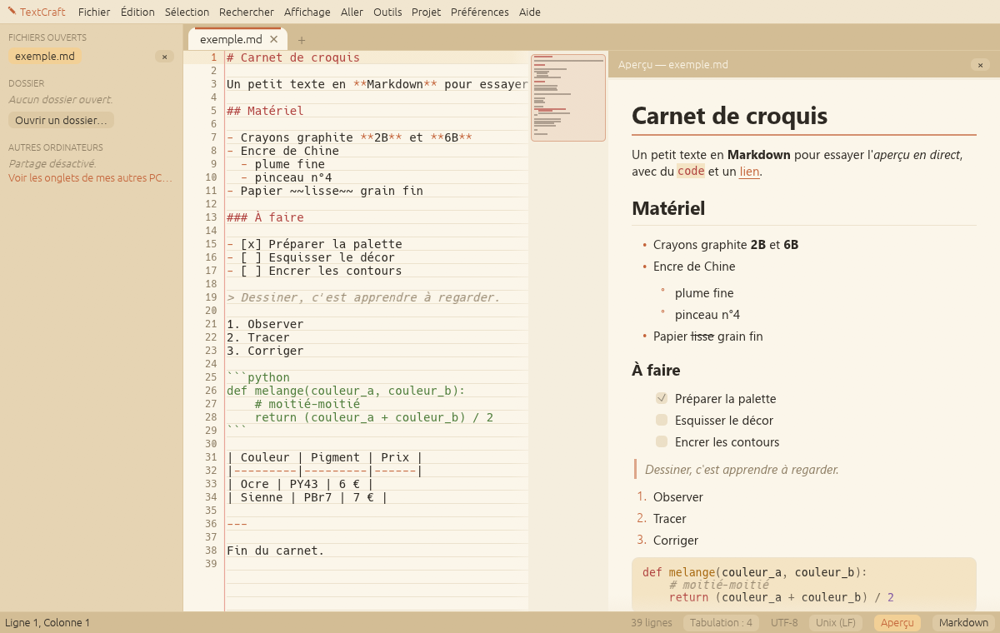

# TextCraft

Un carnet de code rapide et simple, sur papier crème et à l'encre.



## Ce qu'il sait faire

- **Onglets** et **panneau latéral** (fichiers ouverts, dossier du projet).
- **Couleurs de code** pour Rust, Python, JavaScript/TypeScript, C/C++/Java/Go, JSON, Markdown, HTML, CSS, TOML/INI/YAML.
- Numéros de ligne sur **lignes de cahier**, **mini-carte**, règle, retour à la ligne, signets.
- **Palette de commandes** (Ctrl+Maj+P), **ouverture rapide** (Ctrl+P), aller au symbole (Ctrl+R), aller à la ligne (Ctrl+G).
- **Chercher / remplacer** (Ctrl+F, Ctrl+H) et **chercher dans tous les fichiers** (Ctrl+Maj+F).
- Édition de lignes : monter, descendre, dupliquer, joindre, trier, commenter, changer la casse…
- **Aperçu Markdown en direct** à côté du texte (Alt+M).
- **Rien ne se perd** : à la fermeture, tous les onglets sont gardés, même ceux qui ne sont pas enregistrés.
- **Partage entre ordinateurs** du réseau local : voir en lecture seule les onglets ouverts sur un autre PC, protégé par un code secret (tout est chiffré).
- Renommer un onglet ou un fichier (double-clic sur l'onglet).
- Deux thèmes : *papier crème* et *encre de nuit*.

## Installer

Les versions prêtes à l'emploi sont dans les [Releases](../../releases) :

- **Windows** : `TextCraft.exe`, un seul fichier, rien à installer.
- **Linux** (x86_64, Ubuntu 20.04+ / Debian 11+ / Fedora 32+…) : `TextCraft-linux.tar.gz`, puis :

  ```sh
  tar xzf TextCraft-linux.tar.gz
  sh TextCraft-linux/install.sh
  ```

## Compiler soi-même

Il faut [Rust](https://rustup.rs).

```sh
cargo build --release
```

Le programme est ensuite dans `target/release/` (`textcraft.exe` sous Windows, `textcraft` sous Linux).

- Sous **Linux**, `sh linux/install.sh` compile et installe TextCraft dans le menu des applications.
- Sous **Windows avec la chaîne GNU** de Rust (sans Visual Studio), les bibliothèques Windows ont besoin d'un `dlltool` complet, par exemple celui de [WinLibs](https://winlibs.com). Indiquez-le dans `.cargo/config.toml` :

  ```toml
  [target.x86_64-pc-windows-gnu]
  rustflags = ["-C", "dlltool=C:/chemin/vers/mingw64/bin/dlltool.exe"]
  ```

  Avec la chaîne MSVC (Visual Studio), rien de plus n'est nécessaire.
- Une version Linux peut aussi être fabriquée depuis Windows avec [cargo-zigbuild](https://github.com/rust-cross/cargo-zigbuild) :
  `cargo zigbuild --release --target x86_64-unknown-linux-gnu.2.31`

Tests : `cargo test`.

## Fabriqué avec

Rust, [egui / eframe](https://github.com/emilk/egui), [pulldown-cmark](https://github.com/pulldown-cmark/pulldown-cmark), [rfd](https://github.com/PolyMeilleur/rfd), [arboard](https://github.com/1Password/arboard) et les bibliothèques de chiffrement de [RustCrypto](https://github.com/RustCrypto).
